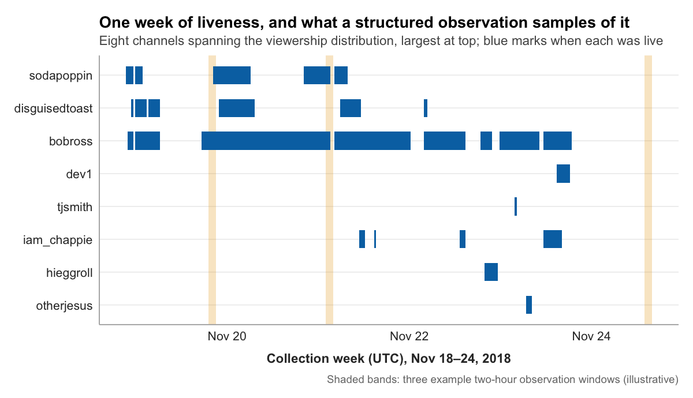

:::: {.content-visible unless-format="epub"}
::: {.chapter-audio}
[Listen in Dr. Leith's voice]{.audio-label}

```{=html}
<audio class="v2v-audio v2v-audio-ug" controls preload="none"><source src="../audio/ch07-ug.mp3" type="audio/mpeg">Your browser does not support audio.</audio>
<audio class="v2v-audio v2v-audio-grad" controls preload="none"><source src="../audio/ch07-grad.mp3" type="audio/mpeg">Your browser does not support audio.</audio>
```

:::
::::


In Chapter 2 you looked at ten rows of the `stream_log` and watched Sodapoppin's audience climb: 27,934 concurrent viewers, then 28,076 a minute later, then 28,203 a minute after that. Two hundred sixty-nine viewers in a hundred and twenty-two seconds. The dataset records that climb to the second. What the dataset cannot tell you is what the climb was.

It could have been a raid, another streamer ending a broadcast and sending their audience over. It could have been a clip going viral on Reddit, pulling in strangers. It could have been the streamer returning from a break, or a game update, or simply the slow accumulation of a good night. The row looks the same in every case: a number, then a larger number, then a larger number still.

The only way to know what a climb like that means is to have watched enough live Twitch to recognize the shapes these numbers make. Someone who has spent real time on the platform can look at a viewer curve and read it. A raid has a signature, a near-vertical jump, often with a wave of near-identical greetings in chat. A viral clip has a different signature, a slower swell of viewers who do not know the room's conventions. The dataset will not label these for you. You bring the labels, and you can only bring them if you have done the looking.

This chapter is about that looking. Before you can turn the Twitch dataset into variables, before you build a codebook and code a single message, you need to know the medium as lived experience rather than as an abstraction. The discipline has a name in qualitative research: **immersion**, sustained and systematic attention to a subject before analysis begins. For a content analyst working with Twitch, immersion takes the form of **structured listening**. You watch streams, you read chat, you take notes, and you do it with the same disciplined attention a music researcher brings to a song or an ethnographer brings to a field site. The dataset is historical, collected across just under six days in 2018. The platform is live in front of you right now, and the behaviors the dataset records, chat moving, audiences swelling and ebbing, streamers working a room, are still there to be watched. Watching them is the work of this chapter.

## Why structured observation matters

Consider two ways to begin a content analysis of Twitch chat.

In the first, you have the dataset. You have a prospectus, and it commits you to comparing how chat behaves in gaming and non-gaming streams. You move straight to a coding scheme: each message is either directed at the streamer or broadcast to the room. You hand the scheme to two coders. They read the chat log as plain text and sort each message into one bucket or the other. You analyze the result.

The problem is not that you have measured nothing. The problem is that you do not know what you have measured. A coder who has never watched Twitch will read the message "LULW" and have no idea that it is an emote, a reaction of laughter, and not a typo or a username. They will read a wall of the same phrase repeated by thirty different accounts and not recognize it as copypasta, the coordinated spam that follows a raid or a notable moment. They will see "@sodapoppin same" and not know whether "same" is agreement with something the streamer said or a stock reply the room produces reflexively. The coding scheme sorts every message into a bucket, confidently, and the buckets do not mean what you think they mean.

In the second approach, you do the same work, but first you watch. Before any coding scheme exists, you spend hours on live streams across the kinds of channels your dataset contains. You read chat as it scrolls. You notice that chat has conventions, that emotes carry meaning that their letter-strings do not, that a message addressed to the streamer by name is often performing for the room rather than expecting a reply. Then you build a coding scheme that reflects what is actually there. The scheme is slower to produce. It is also the difference between a finding and an artifact.

This is the logic the anthropologist Clifford Geertz called **thick description**: a record of behavior rich enough to capture not just what happened but what it meant in context (Geertz, 1973). A thin description of the chat log counts messages. A thick description knows that the count is made of raids and inside jokes and reflexive replies, and it codes accordingly. Structured listening is how a thin dataset becomes something you can describe thickly. The principle is not specific to Twitch. A researcher coding immigration coverage would read dozens of articles before fixing categories; a researcher studying advertising would watch scores of commercials first. The medium changes. The discipline does not.

## Three modes of attention

Structured listening is not idle viewing. It is active, systematic observation, guided by your research question but open to what you did not expect. It works best in three modes, run in sequence.

**Casual watching** is initial exposure. Open several streams across the range of the platform: a large gaming channel, a small one, a Just Chatting stream, an art or music stream. Do not take notes. Do not try to code anything. Just watch, and let the medium be unfamiliar. What surprises you? What feels like a convention you do not yet understand? This is the browsing phase, and its only goal is to replace your assumptions about Twitch with exposure to it.

**Focused watching** is thematic attention. Now choose a few streams and watch them with specific dimensions in mind. The design brief for this kind of observation names three worth tracking, and they are a good place to start. **Chat behavior**: how fast does chat move, who is it addressed to, how does its pace change? **Viewer trajectories**: does the concurrent-viewer count climb, hold, or fall, and what happens on the stream when it moves? **Host moves**: what does the streamer, the host of the room, actually do? Do they read chat aloud, react to it, ignore it, steer it? Watch the same stream more than once with a different one of these dimensions in focus each time. Take brief notes after each pass. You are still describing, not coding.

**Analytical watching** is pattern recognition. Watch a larger number of streams while asking what recurs. Do certain chat behaviors cluster with certain kinds of stream? Are there category-specific conventions, so that chat in a competitive game looks different from chat in an art stream? What cases resist easy description? This is where the contours of your eventual coding scheme start to appear, though you are still documenting patterns rather than forcing categories onto them.

The sequence, familiarize then focus then analyze, holds for any medium. If you were observing news coverage you would skim, then read closely, then read for pattern. The modes are the same; only the material differs.

## Field notes

Observation without a record is just watching television. Research observation produces **field notes**: written, dated, specific accounts of what you saw and what it made you think. Field notes are not polished prose. They are thinking on paper, and their value is that they capture an observation while it is fresh, before it hardens into something you assume you always knew.

Four kinds of field note are worth writing, and the distinction among them is a distinction of purpose.

An **observational note** records what you saw. "Watched a mid-size Just Chatting stream for forty minutes. Chat moved in bursts, near silence while the streamer talked, then a flood every time they asked a question or paused. The flood was mostly short messages, many of them the same two or three emotes. Chat speed seems tied to whether the streamer leaves an opening."

A **methodological note** records a measurement problem. "If I am coding messages as directed at the streamer or not, the bursts after a question are a problem. They are answers to the streamer, so directed, but they are also performance for the room. A coder reading the log as text cannot see the question that prompted them. The codebook may need a rule about messages that respond to streamer prompts."

A **theoretical note** connects an observation to a framework from your reading. "The burst-after-a-question pattern fits uses and gratifications (Katz, Blumler, & Gurevitch, 1973). If viewers are there for social-integrative reasons, the streamer's question is an invitation to participate, and the flood is the gratification being taken up. This suggests chat volume is not a steady trait of a stream but a response to host moves."

A **comparative note** records how cases differ. "Two streams, same hour. The gaming stream's chat ran constant and fast, mostly reacting to the game. The art stream's chat ran slow and conversational, with viewers talking to each other as much as to the streamer. Whatever I end up coding, gaming and non-gaming chat are not the same object."

Keep the notes in a single plain-text document in your course workspace, dated, one entry per observation session, with each entry labeled by the kind of note it is. Set yourself a rhythm, a note every fifteen or twenty minutes of observation, so the record keeps pace with the watching. The notes do not need to be good. They need to exist, for two reasons. The codebook you build in the next chapter will be assembled almost entirely from what they contain. And the qualitative memo you write beside that codebook (Chapter 9) reports the patterns you saw, and every pattern it reports has to trace back to a dated entry here. A memo written from memory describes the topic. A memo written from the notes describes what you saw.

::: {.graduate-extension}
**Reliability planning begins here.** As you take field notes, identify candidate categories, and notice edge cases, you are doing something else at the same time: identifying *where two coders would disagree*, and where you yourself would drift between a first pass and a second. Structured immersion is not only preparation for a codebook. It is the first pass at the reliability problem, and field notes that mark your own uncertainty are its earliest record. Most student studies have one coder, so the record serves two purposes: it marks where your own consistency is most at risk, and it is the raw material for the second-coder counterfactual (Chapter 8), the paragraph that says what a second coder would have added and which finding is most exposed without one. The stakes are what make this early work worth doing. As Hayes and Krippendorff argue, reliability is the precondition for a study's findings to count for anything at all:

> "Conclusions from such data can be trusted only after demonstrating their reliability."
>
> Hayes and Krippendorff (2007, p. 77)
:::

## Manifest and latent content

Structured listening trains a particular kind of judgment, and naming it now will make the next chapter easier. Content analysis distinguishes between two layers of meaning in any message, a distinction Krippendorff (2018) places at the center of codebook design.

**Manifest content** is the surface: features that are explicitly present and that any trained coder can identify with high agreement. Does a chat message contain an `@` mention? Is it shorter than ten characters? Does it contain a known emote token? How many words is it? Manifest features are countable almost mechanically, and reliable coding of them is mostly a matter of a clear rule.

**Latent content** is the underlying meaning, the part that requires interpretation. Is a message friendly or hostile? Is it directed at the streamer or performing for the room? Is "first" a genuine claim or a running joke? Is the mood of chat, taken as a whole, celebratory or restless? Latent features cannot be read off the surface. Two careful coders can disagree about them in good faith.

This is the precise reason structured listening comes before coding. You cannot code latent content reliably until you have built the interpretive framework that turns a subjective impression into a defensible judgment, and that framework is built by watching. The coder who has spent twenty hours on live Twitch knows that a wall of one emote after a big play is celebration, not noise. They learned it the way you are about to learn it: by watching it happen, again and again, until the pattern was obvious. Immersion is how latent content becomes codeable.

::: {.graduate-extension}
**Why disagreement identification matters before the codebook.** Most content-analytic codebook failures come not from poorly defined categories but from underspecified decision rules for boundary cases. Watch a Twitch stream and code a comment as "hostile," and another coder watching the same stream might code it as "sarcastic," because the category boundary was not drawn precisely enough. Structured immersion is when that ambiguity first becomes visible. Field notes should document not just *what* you observe but *where* you are uncertain, because those locations are exactly where a second coder would need explicit guidance, and where your own second pass is most likely to differ from your first. After completing your immersion log, identify three categories where you anticipate the most disagreement with a second coder, and for each write one candidate decision rule that would resolve the ambiguity.
:::

## Qualitative content analysis, named

The work this chapter describes has a name, and naming it now matters because you will be asked to do it on its own terms and not only as preparation for counting. **Qualitative content analysis** is the systematic reading of a body of material to say what it means in context, with the categories drawn from the material rather than fixed in advance. **Quantitative content analysis**, the method Chapters 8 through 13 build, fixes the categories first, applies them the same way to every unit, and reports how often each occurs. Both are content analysis. Krippendorff (2018) defines the method as making replicable and valid inferences from texts to the contexts of their use, and that last phrase is the hinge between the two. Counting establishes what is in the material. Saying what it meant requires the context, and the context is not in the frequency table.

Three things change when the work is qualitative, and they follow from each other. **Categories emerge.** The first pass through the material produces the categories, and they change as you go. Elo and Kyngäs (2008) describe the process as three phases, preparation, organizing, and reporting, with the organizing phase revisited repeatedly rather than finished once. **Latent content is the target.** The next chapter treats latent meaning as the hard case, the thing that threatens reliability and needs decision rules to pin down. Here it is the point. You are trying to say what something means to the people who made it, and the fact that a newcomer would not see it is the reason the reading is worth doing. **Warrant replaces reliability.** Two coders agreeing is not the standard, because the reading rests on interpretive judgment that a second reader is not expected to reproduce mechanically. What replaces it is evidence: enough of the material shown, in the write-up, that a reader can check your reading against it.

Hsieh and Shannon (2005) divide qualitative content analysis into three approaches, and knowing which one you are doing prevents most confusion later. **Conventional** analysis derives its categories entirely from the material; it is the default when little has been written about the setting. **Directed** analysis starts from a theory or an earlier study, uses it to set initial categories, and then extends or revises them against the material; its risk is confirmation, finding the categories you arrived with. **Summative** analysis starts by counting words or features and then interprets what the counts mean in context. Your field notes are conventional analysis in its early form. If your reading is guided by a theory from Chapter 5, it is directed, and you should say so.

Four checks make a qualitative reading one a reader can trust. Show enough of the material that a reader could reach a different reading from it. Say where the pattern does not hold, and what you made of the exceptions. Trace the reading to the material, so a reader can follow how you got from what is on the page to what you claim it means. State your own position, because whether you belong to the community you are reading changes what you can see and what you assume.

A qualitative reading can claim that a body of material carries a particular meaning or works in a particular way, and that the evidence shown supports that reading. It cannot claim a rate. Reading fifty messages closely does not tell you what share of the corpus is like them; that is what the quantitative study is for. The two studies in this book answer different questions about the same material. The qualitative study, written up from your field notes as a memo and later as a set of themes, says what you saw and what it meant. The quantitative study says how often. Keep the two claims separate in the write-up, because the failure to watch for is a paper that reads closely, counts loosely, and reports the two as one finding.

One more thing changes, and it is easy to miss. The quantitative study will take one message as its unit. Meaning in chat, in a comment thread, or in a news story's replies often spans more than one unit: a joke is set up by one person and landed by another, a correction answers something four lines up, and a wall of one emote from thirty accounts is thirty identical messages or one collective act, depending on how you look. In the qualitative reading, choose the unit for the question. The **message** fits a question about individual utterances. The **exchange** fits a question about how people respond to each other. The **episode** fits a question about how a room reacts to a moment. Whichever you choose, say how you divided the material before you say what you found in it.

## From observation to sharper questions

Structured listening does more than prepare you to code. It tells you whether your research question survives contact with the medium.

You arrived at this chapter with a prospectus. Suppose it commits you, as the model prospectus in Chapter 6 did, to comparing chat that is directed at the streamer with chat that is broadcast to the room. Observation will do one of two things to that question. It may confirm it: you watch, and the directed-versus-broadcast distinction turns out to be real, visible, and worth measuring. Or it may complicate it. You may notice, watching chat closely, that a great deal of it is neither directed at the streamer nor broadcast to the room in general, but aimed at another viewer: a reply, an argument, an inside joke between regulars. The two-way distinction you committed to on paper turns out to have a third term in practice.

That is not a failure of the prospectus. It is the cheapest possible moment to learn something the prospectus could not have known. A distinction discovered now becomes a category in the codebook you build next chapter. A distinction discovered after coding becomes a reason to start coding over.

By the end of structured listening you should be able to state two or three **candidate research questions**, grounded in what you actually saw rather than in what you assumed before you watched. If your prospectus question came through observation intact, the candidates are sharper, more operationalizable versions of it. If observation showed that the prospectus question cannot be answered with what the medium offers, the candidates are its honest replacements. Either way, the question you carry into operationalization is a question observation has tested, not just one theory proposed.

## Sampling your observation

You cannot watch all of Twitch, and you do not need to. What you need is a **structured sample** of observation that reflects the range of the thing you will study.

Watching ten streams that are all large competitive-gaming channels will teach you a great deal about large competitive-gaming channels and mislead you about everything else. The Twitch dataset this book uses spans a deliberate range: fifty channels drawn from across the platform's volume distribution, gaming and non-gaming, the heavily populated and the nearly empty. Your observation should span a comparable range. Watch big channels and small ones. Watch gaming streams and Just Chatting and art. Watch at different hours, because a stream at peak time and the same stream in a quiet hour are not the same room.

The goal is not volume but coverage. Twenty streams chosen to span the variety of the platform will teach you more than fifty streams that are all the same kind. This is the same principle that governed the literature search in Chapter 4, where the point of a wide search was to be sure you had seen the shape of the whole conversation, and it is the same principle that will govern statistical sampling in Chapter 10. Representativeness is a discipline that shows up at every stage of a study, and observation is the first stage it shows up in. The Twitch corpus is the shared example here; if your own study is about a comment section, a news archive, or a set of videos, the rule is the same: spread your watching or reading across the range of the material, not across its most visible corner.

{fig-alt="A weekly timeline for eight Twitch channels chosen to span the viewership distribution, largest at top, with blue bars marking when each channel was actually live during the November 18 to 24 collection week. The large channels are live daily for long stretches; the small channels near the bottom appear once or twice all week. Three shaded vertical bands mark example two-hour structured observation windows at different days and hours; the windows are illustrative, and together they intersect the big channels easily but catch the small ones only by deliberate placement."}

## Documenting edge cases

Some of what you observe will resist every category you are tempted to draw. Those moments are not annoyances. They are the most useful thing observation produces, and they deserve their own record: an **edge-case log**, kept alongside your field notes.

An edge case on Twitch might be a message made entirely of emotes, with no words at all. Is that directed at the streamer, broadcast to the room, or something a content analysis of text should treat as a separate kind of object? It might be a copypasta, a block of text every regular recognizes and pastes without reading, which is technically a message but not in any normal sense something a viewer wrote. It might be a message in a language you do not read, or an obvious bot, or a message that is grammatically addressed to the streamer but is plainly a joke for the room. For each, log the case, what makes it ambiguous, and the possible ways a codebook could handle it.

These cases are not exceptions to be ignored. They are the raw material of the **decision rules** that make a codebook work. The model prospectus in Chapter 6 included an "unclassifiable" category; the edge-case log is where you find out what actually lands in it. A codebook written without an edge-case log will meet these messages for the first time during coding, when it is expensive to handle them. A codebook written with one has already decided.

::: {.graduate-extension}
**Planning for the reliability pilot.** The formal reliability protocol (Chapter 8) requires a training phase and a reliability test on a separate data subset. In a two-coder study the training phase has both coders apply the codebook independently to the same units and then reconcile their disagreements. In a single-coder study, which is what most student projects are, the same units are the ones you code and then re-code after a gap to check your own stability. Either way, effective training requires the genuinely ambiguous cases you identified during immersion. Your field notes double as a training-set seed: the hardest-to-categorize observations become the calibration material. Krippendorff argues that unitizing (deciding what counts as a single unit of analysis) is a prior reliability problem most researchers underestimate; as you log edge cases, ask what your unit of analysis is and what makes consistent unitizing difficult.
:::

## Knowing when to stop

Immersion does not last forever. At some point structured listening gives way to structured coding, and the signs that you have reached that point are recognizable.

New streams stop surprising you. You can name three to five dimensions that clearly matter for your research question. Your edge-case log has enough entries to write decision rules from. Your field notes have begun to repeat themselves, confirming patterns rather than turning up new ones. This is the same idea Chapter 4 called **saturation**. There it meant that new literature searches stopped yielding new sources. Here it means that new observation stops yielding new patterns. In both cases saturation is not the claim that you have seen everything. It is the more modest, more useful claim that you have seen enough for the next step to rest on solid ground.

What structured listening leaves you with is five things: conceptual clarity about what your variables actually mean in this medium, a set of candidate categories for each one, the beginnings of the decision rules that will resolve ambiguous cases, the contextual knowledge to recognize when a surface feature is about to mislead you, and a dated record of patterns that your qualitative memo will report. The first four are precisely the raw material of a codebook. Assembling them into one is the next chapter's work.

## Looking ahead

Chapter 8 is where vibes become variables, the move the whole book is named for. You have watched the medium and filled a field-notes document with what you saw. Chapter 8 takes that record and turns it into a codebook: a set of variables, each with defined values, each with a level of measurement, each with decision rules for the cases that do not sort themselves. It is the last step before the data, and the first step that the data will hold you to.

## References

Elo, S., & Kyngäs, H. (2008). The qualitative content analysis process. _Journal of Advanced Nursing_, _62_(1), 107-115. https://doi.org/10.1111/j.1365-2648.2007.04569.x

Geertz, C. (1973). _The interpretation of cultures: Selected essays_. Basic Books.

Hsieh, H.-F., & Shannon, S. E. (2005). Three approaches to qualitative content analysis. _Qualitative Health Research_, _15_(9), 1277-1288. https://doi.org/10.1177/1049732305276687

Katz, E., Blumler, J. G., & Gurevitch, M. (1973). Uses and gratifications research. _Public Opinion Quarterly_, _37_(4), 509-523. https://doi.org/10.1086/268109

Krippendorff, K. (2018). _Content analysis: An introduction to its methodology_ (4th ed.). SAGE Publications.

::: {.graduate-extension}
### Graduate readings

Hayes, A. F., & Krippendorff, K. (2007). Answering the call for a standard reliability measure for coding data. _Communication Methods and Measures_, _1_(1), 77-89. https://doi.org/10.1080/19312450709336664
:::
