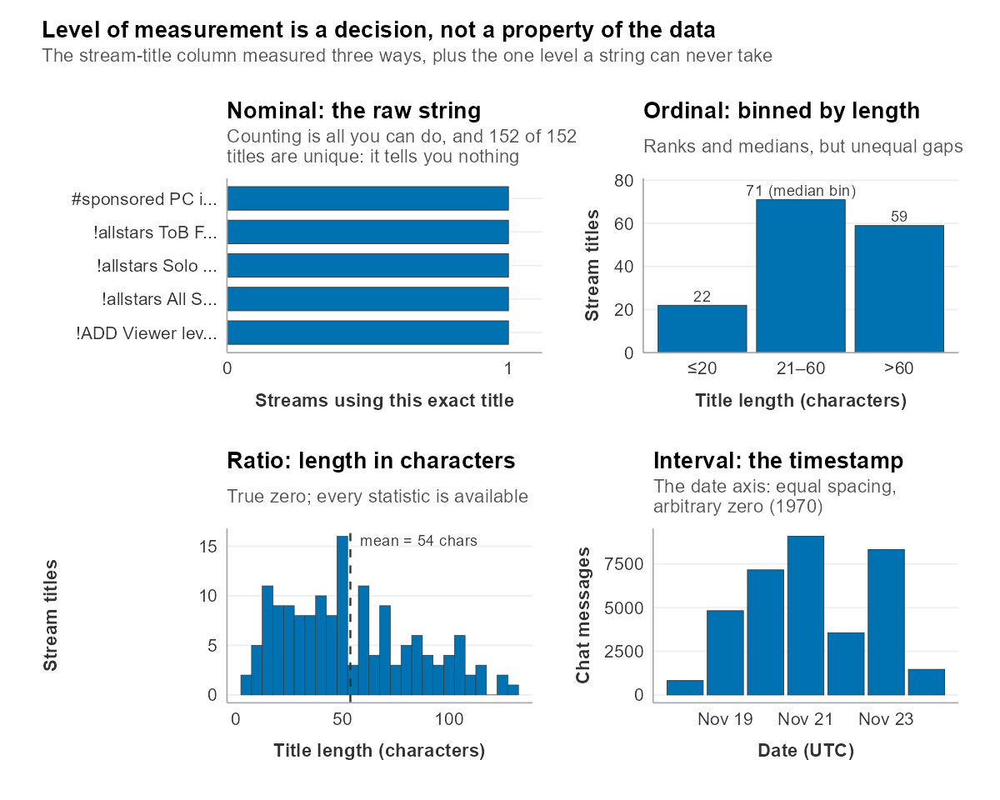
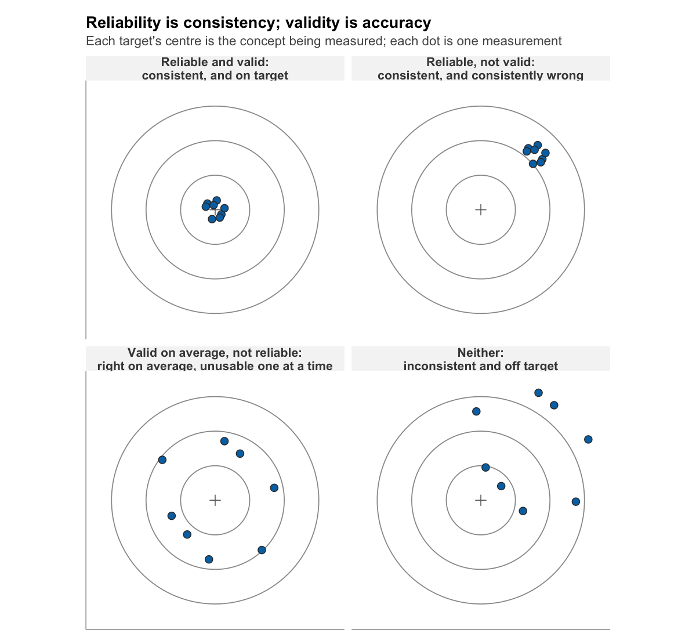

:::: {.content-visible unless-format="epub"}
::: {.chapter-audio}
[Listen in Dr. Leith's voice]{.audio-label}

```{=html}
<audio class="v2v-audio v2v-audio-ug" controls preload="none"><source src="../audio/ch08-ug.mp3" type="audio/mpeg">Your browser does not support audio.</audio>
<audio class="v2v-audio v2v-audio-grad" controls preload="none"><source src="../audio/ch08-grad.mp3" type="audio/mpeg">Your browser does not support audio.</audio>
```

:::
::::


Somewhere in the field-notes document you built in Chapter 7 is an entry like this one: "Chat in the art stream felt calmer and more conversational than chat in the gaming stream. People talked to each other, not just to the streamer." That sentence is a real observation. You earned it by watching. It is also, as written, useless to a coder.

"Calmer" is not a category anyone else can apply. "More conversational" is not something you can count. If you handed that field note to two people and asked them to sort a thousand chat messages by it, they would produce two different thousand-message sortings, and you would have no way to say which was right. The observation is true and the observation is unmeasurable, and the distance between those two facts is the distance this chapter closes.

The book is named for this chapter. **Operationalization** is the disciplined process of turning a vibe, a holistic and subjective impression, into a variable, an explicit and replicable measurement. It is the central methodological act of content analysis. Done well, it preserves what you noticed during immersion while making it something a stranger could measure the same way you did. Done badly, it produces numbers that look like findings and are actually artifacts. By the end of this chapter you will have a draft codebook: the document that turns your research question into a set of variables precise enough to code.

## The operationalization gap

Take the variable the running example has been circling since Chapter 6: the target of a chat message, who it is aimed at. Chapter 7's observation complicated the simple two-way split, so call the categories directed at the streamer, broadcast to the room, directed at another viewer, and unclassifiable.

A vague attempt at operationalizing this would be: "Code each message by who it is for." The problem surfaces the moment a coder meets a real message. A viewer types "same." Who is that for? A viewer types "LULW." A viewer types "no way that just happened." Each of these could plausibly be aimed at the streamer, at the room, or at another viewer, and a coder with only "code by who it is for" to go on will simply guess. Two coders will guess differently. The variable is named but not operationalized.

A better attempt specifies observable criteria. "A message is **directed at the streamer** if it contains an at-mention of the streamer's channel name, or is a second-person address ('you', 'your') that responds to something the streamer said or did in the preceding moments. It is **directed at another viewer** if it contains an at-mention of a non-streamer account, or is a reply to a specific prior message. It is **broadcast to the room** if it is a reaction or comment with no specific addressee. It is **unclassifiable** if none of these criteria settle the question." Now a coder has something to apply. The criteria are observable, the categories are defined, and two coders working from them will land in the same place far more often than two coders working from a vibe.

That is the work. Operationalization specifies, in advance and in writing, exactly what observations count as evidence for a concept. It is not unique to Twitch. A scholar coding immigration coverage must turn "this article feels sympathetic" into a defined frame variable with observable criteria. A health researcher must turn "this ad feels fear-based" into a category a coder can apply. The medium changes; the act does not.

## Conceptual and operational definitions

Every variable needs two definitions, working together.

A **conceptual definition** says what the variable means in the abstract. It draws on your reading and your theory, and it answers one question: what is this variable meant to capture? For message target, a conceptual definition might read: "The intended addressee of a chat message, reflecting whether the message functions as participation with the streamer, with the broader chat collective, or with a specific other viewer." That is clear about the idea. It is not yet a recipe. Say where the idea comes from: name the source whose definition you adapted, and if the idea is your own, say so and give one sentence defending it. A conceptual definition with no source is a guess about what the field means by a word.

An **operational definition** is the recipe. It says exactly what a coder does to assign a value, in enough detail that a stranger could follow it and measure the same thing you measured. The criteria in the previous section, the at-mention rule, the second-person-address rule, the reply rule, are the operational definition of message target. The conceptual definition tells you what the variable is for. The operational definition tells you what counts as evidence.

You need both, and they discipline each other. A conceptual definition with no operational definition is an idea you cannot measure. An operational definition with no conceptual definition is a procedure that has lost track of why it exists, which is how a study ends up precisely measuring something nobody wanted to know. Writing the two side by side, for every variable, is the first concrete step toward a codebook.

## How operationalization goes wrong

Four failures recur often enough to be worth naming, because naming them is the fastest way to catch them in your own work.

The first is **conflating concepts**: treating two related but distinct ideas as if they were one. A study that measures a streamer's community by counting chat messages has conflated community with activity. A large channel can have a fast chat that is also shallow and anonymous, thousands of strangers reacting in parallel and never to each other. Volume is real, but it is audience activity, not community, and the fix is to say so plainly: either defend message volume as a deliberate, narrow proxy or measure community more directly.

The second is the **unjustified proxy**: using an indirect measure without explaining why it stands in for the thing you care about. Measuring stream quality by viewer count is the standard example. Viewer count reflects discoverability, time of day, the popularity of the game being played, and a channel's existing momentum, none of which is quality. A proxy is not forbidden, but an undefended one is, and the fix is to defend it or replace it.

The third is **oversimplification**: collapsing a concept with several dimensions into a single indicator that misses most of it. Chat engagement is not only how many messages appear. It is also who is talking, whether they are talking to each other, and in what spirit. A message count captures one dimension and silently discards the rest. The fix is either to measure the other dimensions too or to state honestly that the study addresses message volume specifically, not engagement in full.

The fourth is the **unmeasurable definition**: an operational definition that cannot actually be carried out. "A message is sincere if the viewer genuinely means it" defines sincerity in terms of something no coder can observe. The fix is to operationalize through observable indicators, the surface features that, taken together, are the best available evidence for the thing you cannot see directly.

The thread running through all four is the same. An operational definition is a promise that someone else could follow your recipe and measure what you measured. Each mistake breaks that promise in a different way.

## Levels of measurement

Once a variable is operationalized, it has a **level of measurement**, and that level determines what you are later allowed to do with it. The four levels are easy to remember as **NOIR**: nominal, ordinal, interval, ratio.

The `stream_log` table is a convenient place to see all four, because its columns happen to span the range. Recall the preview from Chapter 2: channel, title, game, viewers, date.

A **nominal** variable sorts cases into categories that have no inherent order. The `game` column is nominal: Fortnite, Just Chatting, Art, Hearthstone are categories, and no arithmetic relates them. Fortnite is not greater than Art. The `channel` column is nominal too, and so, in its raw form, is `title`: a stream title is a string, and one string is not ranked above another. With a nominal variable you can count how often each category appears and identify the most common one, but you cannot average it. The average of Fortnite and Art is not a category.

An **ordinal** variable sorts cases into categories that do have an order, but where the distance between ranks is not constant. If you took stream titles and binned them by length into short, medium, and long, length-bin would be ordinal: long outranks short, but the gap from short to medium is not guaranteed to equal the gap from medium to long. With an ordinal variable you can rank cases and find the median, but the mean is not strictly meaningful.

An **interval** variable has equal, constant distances between values, but its zero point is arbitrary rather than meaning "none." The `date` column is the example, and it carries a caveat worth stating now because Chapter 11 will spend real effort on it. The dataset stores `date` as a bigint count of milliseconds since midnight on January 1, 1970. Once converted to a timestamp, it is interval-level: the distance from one minute to the next is constant across the whole column, but the zero point, 1970, does not mean "no time." It is a convention. You can meaningfully subtract two timestamps to get a duration. You cannot meaningfully say one timestamp is "twice" another, so no message is "twice as late" as another. The stored number looks like a count, so be precise about which variable you mean. The posting date and time of a message is interval. An elapsed time, such as the hours since the stream started, is ratio: zero hours means the stream has only just begun, and three hours genuinely is twice an hour and a half. The duration you get by subtracting two timestamps is ratio for the same reason.

A **ratio** variable has equal intervals and a true zero that genuinely means "none." The `viewers` column is ratio: zero viewers means no one is watching, and because that zero is real, a stream with 28,000 viewers genuinely has twice the audience of one with 14,000. Ratio variables permit the full range of arithmetic. Most counts are ratio-level: viewers, message length in characters, number of messages.

Notice what happened with stream title. As a raw string it is nominal. Measured as a character count it is ratio, because a title can have zero characters and a true zero exists. Binned into short, medium, and long it is ordinal. One column, three possible levels, depending entirely on how you operationalize it. Level of measurement is not a property the data hands you. It is a property of the decision you make.

{fig-alt="Four panels measure stream titles at different levels. Nominal: five example titles each used exactly once, because all 152 titles in the fixture are unique, so counting categories reveals nothing. Ordinal: titles binned by length into 22 short, 71 medium, and 59 long, with the medium bin holding the median. Ratio: a histogram of title length in characters with a mean of 54, where a true zero makes every statistic available. Interval: chat messages per day across the week, where the interval variable is the date on the horizontal axis, which has equal spacing but an arbitrary zero; the bar heights are counts, which are ratio. A raw string can never be measured at the interval level."}

Levels matter because they govern the statistics available to you later. A nominal variable can be tested for association with a chi-square test. A ratio variable can be averaged, correlated, and entered into the kind of test Chapter 13 runs. If you operationalize an interesting variable at the nominal level when it could have been ratio, you have quietly narrowed what your study can conclude before you have coded a single case.

The rule of thumb is short enough to carry. A **nominal** variable is described with counts and the most common category, and compared across groups with a chi-square test; it has no mean. An **ordinal** variable adds the median and can be ranked, but its mean is not strictly meaningful. An **interval** or **ratio** variable is described with the mean, the median, and the standard deviation, and compared with a t-test or a correlation. For every variable in your codebook, write one sentence saying what its level allows you to do later and what it rules out. That sentence is where most students discover that a variable they coded as three ordered labels could have been a count.

## Two kinds of variable

The `stream_log` columns make NOIR concrete, but they also illustrate something about where variables come from, and the distinction matters for what comes next.

Some variables arrive in the dataset ready-made. `viewers` is already a number in a column. `game` is already a category. For variables like these, the operationalization work is mostly classification: decide the level of measurement, decide whether you will use the column raw or transform it, and move on. There is no coding to do, because the platform already did it.

Other variables do not exist until you build them. Message target is not a column in `chat_log`. Nothing in the dataset records whether a message was aimed at the streamer or the room. That variable exists only after a human coder reads each message and assigns a value, and a coder can only do that consistently if you have given them a precise, written set of instructions. For variables like these, the operationalization work is most of the work, and the instructions have a name. They are a codebook.

The rest of this chapter is about the second kind. But first, the standard those instructions are built to meet.

## Reliability and validity

An operational definition can be perfectly precise and still be bad measurement. Two criteria tell you whether your measurement is any good: reliability and validity.

**Reliability** is consistency. A measure is reliable if it produces the same result under the same conditions. A bathroom scale that reads 150, then 162, then 147 as you step on and off without changing is unreliable, and its readings are worthless regardless of your actual weight. For content analysis, the standard form of reliability is **inter-coder reliability**: if two trained coders apply your codebook to the same messages independently, do they agree? If they do not, the codebook is not yet measuring anything stable, and no amount of analysis downstream will repair that. Inter-coder reliability is quantified with statistics, Cohen's kappa and Krippendorff's alpha among them, that correct for the agreement two coders would reach by chance alone. Chapter 10 covers those statistics and how to act on them; for now, the point is conceptual. A codebook's job is to make independent coders agree. When you are the only coder, the form of reliability you can measure is your own consistency over time, and the next section says how.

**Validity** is accuracy. A measure is valid if it captures the thing it claims to capture. Validity and reliability are independent. A scale calibrated ten pounds light is perfectly reliable, it reads the same every time, and perfectly invalid, it is wrong every time. The reverse can also happen: a measure can be accurate on average but so inconsistent that any single reading is unusable. Validity has several forms worth knowing by name. **Face validity** asks whether the measure looks, on inspection, like it assesses the intended concept. **Content validity** asks whether it covers all of the concept and not just a convenient slice. **Construct validity**, the most demanding, asks whether the measure behaves the way theory says it should, relating to other variables as predicted.

One principle ties the two together and is worth holding onto: reliability is necessary but not sufficient for validity. A measure that is inconsistent cannot be accurately capturing anything, so unreliability rules validity out. But a measure can be perfectly consistent and still measure the wrong thing. You need both, and you get reliability first, because a codebook is the instrument that produces it.

Validity has no statistic to compute, so the working check is a sentence. For each variable, write down what would make you doubt that it measures the idea in its conceptual definition. For message target the sentence might be: "I would doubt this variable if most messages coded as directed at the streamer turned out to be stock phrases the room types whenever anyone is named, because then the code is capturing a habit of the room and not an addressee." A doubt sentence that could be written about any variable ("if coders disagreed") is not doing the work; the sentence has to name the specific way this variable could miss its idea.

{fig-alt="Four target diagrams, each with a cross at the bullseye standing for the concept being measured and dots standing for repeated measurements. Reliable and valid: dots cluster tightly on the bullseye. Reliable but not valid: dots cluster just as tightly but well off-center, consistent and consistently wrong. Valid on average but not reliable: dots scatter widely around the center, right on average and unusable one at a time. Neither: dots scatter widely and off-center. A schematic illustration, not data."}

## When you are the only coder

Most published content analyses use two or more coders, and most student studies use one. That difference changes what reliability can mean for your study, and it has to be stated rather than hidden.

With one coder, there is no second person to agree with. What you can measure instead is **intracoder reliability**, usually called **stability**: whether you, applying your own codebook to the same items twice, reach the same codes. The procedure is simple. Code a set of items. Wait at least 48 hours, long enough to forget the individual calls. Hide your first codes, re-code the same items from the written rules alone, and compare the two passes with the same statistics Chapter 10 uses for two coders. The function does not care whether the two columns came from two people or from one person on two days.

Stability is a weaker claim than agreement between two coders, and it must be reported as what it is. Two coders agreeing shows that the written rules carry the classification on their own. One coder agreeing with themself shows that the rules, plus whatever that coder remembers and assumes, produce the same answer twice. So a stability figure is never written up as intercoder agreement, and the write-up says in plain words that you were the only coder and that every reliability claim is a claim about your own consistency.

How much to re-code is a judgment, and the frame for it is this. A study meant for publication re-codes 10 to 20 percent of its items. In a first study, re-coding about 10 percent is enough to practice the mechanics and to catch a rule that has drifted. For a pilot of a few dozen items, re-code at least a quarter of them, so the figure rests on more than two or three cases.

Because stability is weaker, a single-coder study leans on safeguards against drift, and the codebook names the ones in use. Five are standard. Write every category's inclusion and exclusion rule before coding begins. Keep two or three prototypical examples per category, drawn from your own material, and code against them. Freeze the codebook before the full pass, and log every later change with its date and reason. Keep an ambiguous-case memo, and settle each hard case against the written rule instead of by feel. Code in a fixed order with source details hidden wherever that is possible, so that who sent a message does not color how it is coded.

The last part of the single-coder note is the **second-coder counterfactual**: one paragraph saying what the study would have done with a second coder. It has four parts. How many items you would have double-coded. Which statistic you would have reported. How you would have trained the second coder and settled disagreements. And which of your findings is most at risk without one, which is usually the finding that rests on your most interpretive variable. Writing the counterfactual is not an apology. It is how a reader learns where the study's weak point is, and a researcher who can name it understands the study.

One rule holds whatever the figure turns out to be: report it. A disappointing stability figure, reported with what you changed because of it, is a finding about the codebook. A disappointing figure left out of the write-up is a reason to distrust everything else in it.

::: {.graduate-extension}
**The formal intercoder reliability protocol, and its single-coder form.** Your codebook is the operational heart of the study, but a codebook that works for one coder is not necessarily a reliable instrument: it is not finished until it has been applied to a sample of your data a second time, by a second coder or by you after a gap, and the agreement has been measured and reported. The complete two-coder protocol has four steps, and it is the protocol your second-coder counterfactual describes. *First*, the second coder receives the codebook (no walk-through, no hints) and codes a training set of 20 to 30 units independently. *Second*, the two coders compare their coding and discuss every disagreement; no new production data is coded at this stage. *Third*, the codebook is revised to add decision rules for all identified disagreements. *Fourth*, the second coder codes a fresh reliability sample, separate from the training set, independently, and the agreement on this fresh sample is the κ that gets reported. The single-coder form keeps the shape: code the training set, re-code it after at least 48 hours with the first codes hidden, revise the rules where the two passes differ, then draw a fresh reliability sample kept separate from the items the codebook was built and revised on, and report the stability figure from that sample, named as stability. Reusing the build items makes the figure read higher than it should, because you have already settled those cases. Lombard et al. (2002) recommend reporting more than one reliability statistic; Hayes and Krippendorff (2007) argue for one standard measure, Krippendorff's alpha. Your protocol picks one position and says why. Hayes and Krippendorff state the standard the protocol exists to meet in a single line:

> "Conclusions from such data can be trusted only after demonstrating their reliability."
>
> Hayes and Krippendorff (2007, p. 77)
:::

## The codebook

A **codebook** is the complete set of instructions for coding your data. It is not paperwork you assemble after the fact to satisfy a methods requirement. It is the instrument itself.

The most useful way to think about a codebook is as source code. If your coding process were a computer program, the codebook would be the program: it specifies every operation, handles every conditional, and ensures that two processors, here two human coders, running the same program on the same input produce the same output. Without it, you are coding from memory and intuition, and memory and intuition are exactly what reliability requires you to eliminate. Neuendorf (2017) describes the codebook as the heart of a content analysis, and the description is not decorative. The clarity of the codebook is the single strongest predictor of whether your coders will agree.

A complete codebook has six parts.

The **study overview** says in three or four sentences what question the study asks, what material is being coded, and from what period. It is short, and it is first, because a coder who does not know what the study is for cannot tell which edge cases matter.

The **unit of analysis** states exactly what one coded case is. This must be unambiguous. "Code the chat" is not a unit of analysis. "The unit of analysis is a single chat message, defined as one row of the `chat_log` table: one sender, one message string, one timestamp" is. If the unit is vague, every count you later report is vague. Every variable is coded on that unit; a variable that describes the whole stream does not belong in a codebook whose unit is one message.

The **variables and their categories** list what you are measuring and what values each variable can take. For each variable you give the conceptual definition with its source, the operational definition, the level of measurement, every category with a short description, and the edge-case rules for that variable. Every value is listed with what it means, and the list does not trail off with "etc."

The **decision rules** tell coders what to do with the cases that do not sort themselves. This is where the edge cases from your Chapter 7 observation log earn their keep. Every ambiguous case you wrote down becomes a rule, and a rule says what the coder does. "Emote-only messages are coded broadcast to the room" is a rule. "Be careful with sarcasm" is an intention: it names a worry and leaves the decision to the coder, which is exactly what a codebook exists to prevent. Write at least two rules per variable, drawn from cases your material actually produced. Complications that turn up during the pilot (Chapter 10) are added here as dated rules, so the codebook carries its own history.

The **examples** give two or three prototypical cases for each category, taken from your own material rather than invented, so coders have a reference for what good coding looks like and a set of cases to train on. An invented example shows what you imagine the category to be; a real one shows what it is. When you quote a message as an example, leave the sender's name out.

The **coder note** says who codes, and how consistency will be checked. In a study with one coder it is the single-coder note from the previous section: the plain statement that you are the only coder, the safeguards you are using, and the second-coder counterfactual. In a study with two coders it is the protocol they follow.

Two principles govern the categories of any variable. They must be **exhaustive**, meaning every case can be coded, which is what the "unclassifiable" or "other" catch-all guarantees. And they must be **mutually exclusive**, meaning every case fits exactly one category. If a message can honestly be placed in two categories at once, the categories overlap, and overlap destroys reliability because two coders will split on it forever. The fix is either sharper category definitions or a decision rule that assigns precedence. A catch-all is necessary, but if more than roughly one case in ten lands in it, the category scheme is incomplete and needs work.

## A codebook for the chat study

Here is a draft codebook for the running example, the study the prospectus in Chapter 6 committed to and the observation in Chapter 7 sharpened. It has three variables, enough to show the shape of a codebook; a real study usually carries four or more. It is deliberately a draft: the decision rules will grow as the pilot turns up cases they do not yet cover.

> **Codebook: chat message target and form**
> **Study overview.** The study asks whether chat on gaming and non-gaming Twitch channels differs in who messages are aimed at and how long they run. The material is the chat log of fifty channels collected over six days in November 2018. Messages are coded from the log, without the video.
>
> **Unit of analysis.** A single chat message, defined as one row of `chat_log`: one sender, one message string, one timestamp. Each message is coded independently of the messages around it, except where a decision rule explicitly says otherwise.
>
> **Variable 1: message target.** Conceptual definition: the intended addressee of the message. Operational definition: after reading the message, the coder assigns one category. Categories: **directed at streamer** (contains an at-mention of the streamer's channel name, or is a second-person address responding to the streamer); **directed at another viewer** (contains an at-mention of a non-streamer account, or is a reply to a specific prior message); **broadcast to the room** (a reaction or comment with no specific addressee); **unclassifiable** (none of the above criteria settle the question). Level: nominal.
>
> **Variable 2: message length.** Conceptual definition: the verbal extent of the message. Operational definition: the count of characters in the message string, including spaces and emote tokens. This is a derived measure, computed rather than judged. Level: ratio.
>
> **Variable 3: contains emote.** Conceptual definition: whether the message uses Twitch's emote vocabulary. Operational definition: coded yes if the message contains at least one token from the project's emote list, no otherwise. Level: nominal.
>
> **Decision rules.** Rule 1, precedence: if a message both at-mentions the streamer and performs for the room, code it directed at streamer; the explicit address takes precedence. Rule 2, emote-only messages: a message consisting only of emote tokens is coded broadcast to the room for target unless it contains an at-mention. Rule 3, copypasta: a recognized copypasta block is coded by its content like any other message; its status as copypasta is not itself a category. Rule 4, non-English messages: code target if the addressee is determinable from at-mentions or structure; otherwise code unclassifiable. Rule 5, bot accounts: messages from known bot accounts are coded unclassifiable for target and noted for possible exclusion.
>
> **Coder note.** One coder. Every reliability claim is a claim about that coder's own consistency, checked by re-coding a share of the sample after at least 48 hours with the first codes hidden. Safeguards in use: the inclusion and exclusion rules above, written before coding; three examples per category from the log; the codebook frozen before the full pass, with later changes dated and logged. Second-coder counterfactual: a second coder would double-code 50 messages drawn fresh from the sample, Cohen's kappa would be reported, training would use the examples and the first ten disagreements, and the finding most at risk is anything resting on message target, the one variable that requires judgment.

Three variables, spanning two manifest measures a coder can apply almost mechanically and one latent measure that requires real judgment, spanning nominal and ratio levels, every category exhaustive and mutually exclusive, every decision rule traceable to something observation actually turned up, and a plain statement of who codes and how consistency is checked. That is a draft codebook. It is enough to start.

::: {.graduate-extension}
**The threshold and the calculation.** Before production coding begins, the agreement has to clear a bar: the standard threshold for Cohen's κ is ≥ 0.70 (Landis & Koch, 1977), and below it the codebook requires further revision. Name the threshold you apply and its source, and if your figure is a stability figure, add the sentence that says it is a weaker claim than agreement between two coders. The reliability sample should contain at least 50 coded units, or 10 percent of the corpus if that is larger, and rarely needs to exceed 300 (Lombard et al., 2002); for variables with low base rates (rare codes), 100 or more units are preferred. `v2v::reliability()` computes κ with interpretation labels. For your own study, simulate the scenario where two passes agree on 40 of 50 units: run `v2v::reliability()`, read the κ it returns, decide whether this codebook clears the 0.70 threshold, and work out what you would revise if it does not.
:::

## Looking ahead

Chapter 9 is first contact with the data inside R. You have a research question, a theoretical frame, a prospectus, a field-notes document, and now a draft codebook. What you have not yet done is open the dataset in the tool you will analyze it with. Chapter 9 is where the planning stops and the code begins: you will load `chat_log` and `stream_log`, look at their structure, and confirm that the data you have designed a study around is the data you actually have.

## References

Krippendorff, K. (2018). _Content analysis: An introduction to its methodology_ (4th ed.). SAGE Publications.

Neuendorf, K. A. (2017). _The content analysis guidebook_ (2nd ed.). SAGE Publications.

::: {.graduate-extension}
### Graduate readings

Hayes, A. F., & Krippendorff, K. (2007). Answering the call for a standard reliability measure for coding data. *Communication Methods and Measures*, *1*(1), 77–89. https://doi.org/10.1080/19312450709336664

Lombard, M., Snyder-Duch, J., & Campanella Bracken, C. (2002). Content analysis in mass communication: Assessment and reporting of intercoder reliability. *Human Communication Research*, *28*(4), 587–604. https://doi.org/10.1111/j.1468-2958.2002.tb00826.x
:::
